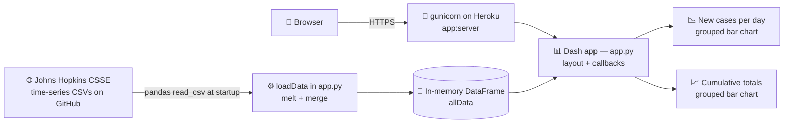

# 📊 COVID-19 Chart

> An interactive [Plotly Dash](https://dash.plotly.com/) dashboard charting the case history of the COVID-19 pandemic — confirmed cases, deaths, and recoveries by country and state/province, built in the pandemic's opening weeks (March 2020) and deployed to Heroku.

**Status: archival.** The upstream Johns Hopkins dataset this app reads stopped updating in March 2023, so the charts show the pandemic's historical arc, not live numbers. Commits since then are automated dependency fixes (Snyk / Dependabot).

---

## 📑 Table of Contents

- [🏗️ Architecture](#️-architecture)
- [📊 Data Source](#-data-source)
- [🚀 Running Locally](#-running-locally)
- [⚠️ Known Quirks](#️-known-quirks)

---

## 🏗️ Architecture

A single-file Dash application. At startup it downloads the Johns Hopkins CSSE time-series CSVs, melts them into one tidy pandas DataFrame held in memory, and serves a page with three controls (country, state/province, metrics) and two charts. Dash callbacks re-filter the in-memory DataFrame on every selection — there is no database and no per-request fetching.



**Components:**

- 📄 **`app.py`** — the entire application: data loading, page layout, and the three callbacks
- 🧮 **Data prep** — `loadData()` melts each wide CSV into tidy rows and the series merge into one DataFrame; `nonreactive_data()` derives daily-new values by diffing the cumulative columns
- 🔁 **Callbacks** — changing the country repopulates the state/province dropdown; both charts re-render from the filtered DataFrame
- 🚀 **Deployment** — [`Procfile`](Procfile) runs `gunicorn -w 4 app:server`; [`runtime.txt`](runtime.txt) pins Python 3.10.8 (the default branch is named `heroku` for this deploy)

---

## 📊 Data Source

All data comes from the [Johns Hopkins CSSE COVID-19 repository](https://github.com/CSSEGISandData/COVID-19), specifically its [global time-series CSVs](https://github.com/CSSEGISandData/COVID-19/tree/master/csse_covid_19_data/csse_covid_19_time_series) (confirmed cases and deaths), fetched over HTTPS at startup.

---

## 🚀 Running Locally

```bash
python -m venv .venv && source .venv/bin/activate
pip install -r requirements.txt
python app.py
```

Then open [http://127.0.0.1:8050](http://127.0.0.1:8050). The first load is slow — the app downloads and melts the full time-series CSVs before serving.

---

## ⚠️ Known Quirks

- 🔁 **Recovered duplicates deaths** — as committed, `loadData()` is called with the deaths CSV twice; the second load is labelled `CumRecovered`, so the Recovered metric mirrors the deaths series rather than true recoveries.
- 🐢 **Load-at-import** — all data is fetched and processed at startup; there is no caching or refresh.
